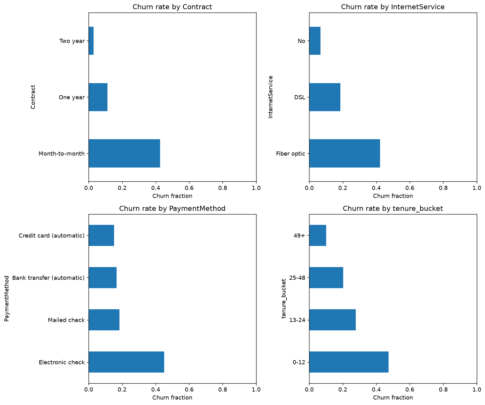
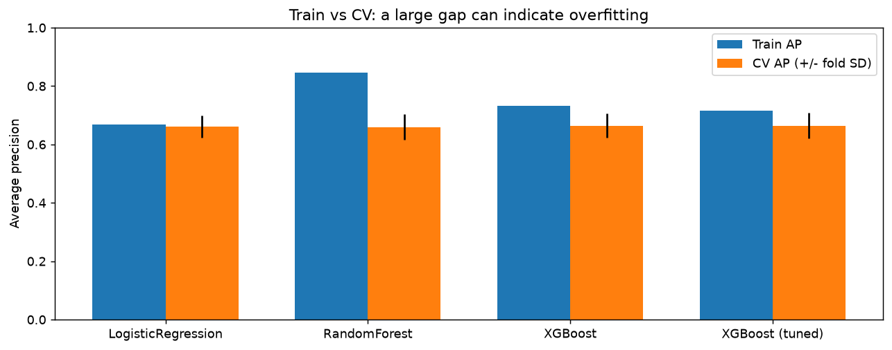
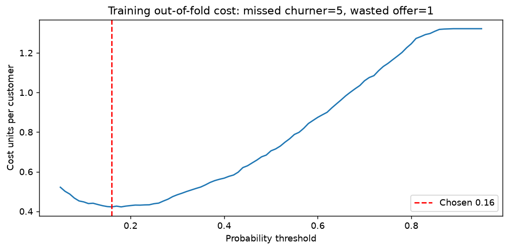
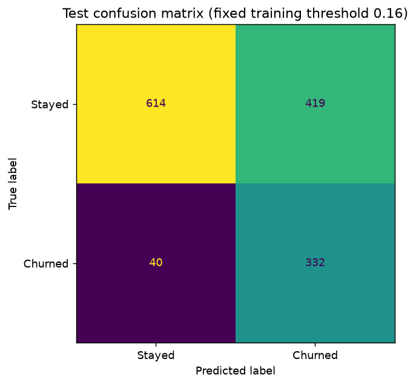
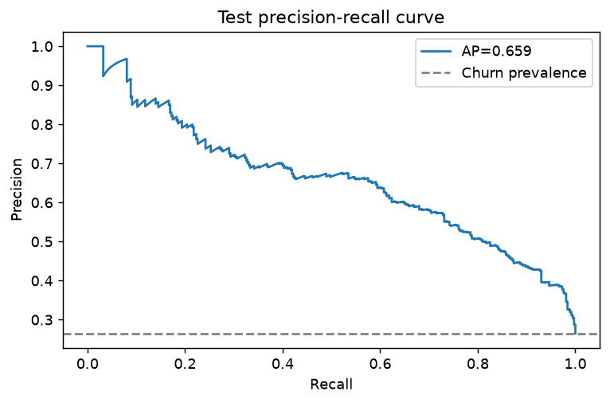
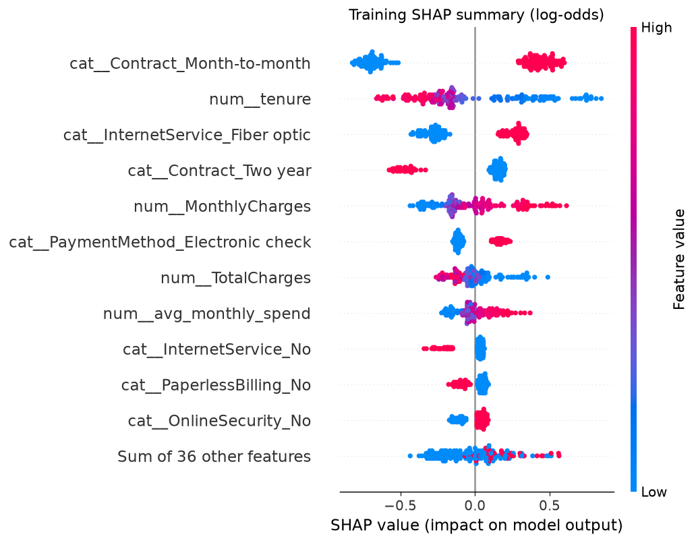
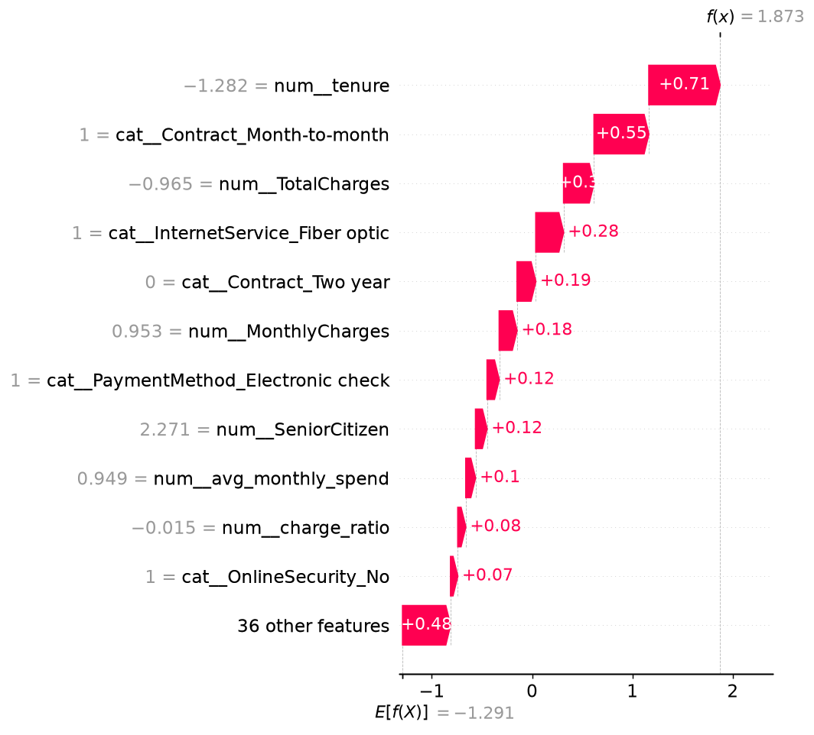

# Customer Churn Prediction

A complete, local Python project teaching data quality, leakage prevention, imbalanced classification, feature engineering, fair model comparison, cost-based decisions, and SHAP. Nine executed Jupyter notebooks explaAin the reasoning; equivalent Python scripts call shared functions in `src/`.

The goal is to identify telecom customers for retention review. A prediction does not establish that an offer will prevent churn.

## Dataset

Download [IBM Telco Customer Churn: Kaggle blastchar/telco-customer-churn](https://www.kaggle.com/datasets/blastchar/telco-customer-churn). Extract `WA_Fn-UseC_-Telco-Customer-Churn.csv` and copy/rename it to **data/raw/telco.csv**. A Kaggle account may be required. No fabricated data is used.

The original has **7,043 rows, 21 columns, and 26.54% churn**. Each row is a customer; Churn is Yes/No. Eleven TotalCharges entries are whitespace strings, all at tenure zero. Pandas 3 calls their text dtype `str`; older pandas commonly reports `object`. Numeric conversion reveals this hidden missingness.

Cleaning leaves **7,021 rows**, removing 22 identical records after dropping IDs. A seed-42 stratified 80/20 split gives **5,616 training and 1,405 test rows**. The split occurs before EDA, so test associations cannot influence modeling choices.

## Results

PR-AUC here means **average precision (AP)**, not trapezoidal area under the plotted PR curve. Training CV means and held-out scores are different evaluation sources.

| Model / rule | Evaluation source | ROC-AUC | PR-AUC (AP) | Precision | Recall | F1 |
|---|---|---:|---:|---:|---:|---:|
| Dummy, most frequent | Training 5-fold CV | 0.5000 | 0.2644 | 0.0000 | 0.0000 | 0.0000 |
| Balanced logistic regression | Training 5-fold CV | 0.8465 | 0.6603 | 0.5182 | 0.8034 | 0.6300 |
| Random forest | Training 5-fold CV | 0.8461 | 0.6598 | 0.5395 | 0.7650 | 0.6327 |
| Initial XGBoost | Training 5-fold CV | 0.8478 | 0.6647 | 0.6666 | 0.5178 | 0.5827 |
| Tuned XGBoost | Training 5-fold CV | 0.8493 | 0.6646 | 0.6747 | 0.5165 | 0.5850 |
| Tuned XGBoost, threshold 0.50 | Held-out test | 0.8440 | 0.6592 | 0.6725 | 0.5134 | 0.5823 |
| Tuned XGBoost, threshold 0.16 | Same held-out predictions | 0.8440 | 0.6592 | 0.4421 | 0.8925 | 0.5913 |

The dummy achieves **73.56% accuracy but zero recall**. Initial XGBoost wins by mean training CV AP, but its advantage over logistic regression is small relative to fold variation. Tuned XGBoost CV AP is **0.6646 +/- 0.0429** (sample fold SD), with no meaningful tuning gain. Logistic regression remains a credible simpler option. Reused selection folds make the selected CV score optimistic; this is not nested CV.

Test AP is 0.0054 below tuned CV AP. One small gap cannot establish stability on future customers. Test Brier score (probability error, lower is better) is **0.1358**.

The threshold is selected from **training out-of-fold predictions**. Each training customer's score comes from a pipeline not fitted on that row. We scan `np.linspace(0.05, 0.95, 91)` and minimize **5 * missed churners + wasted offers**. Ties choose the lower cutoff. The selected **0.16** threshold is locked before test prediction.

| Fixed offer rule | Test missed churners | Test wasted offers | Test cost units |
|---|---:|---:|---:|
| Threshold 0.50 | 181 | 93 | 998 |
| Training-selected 0.16 | 40 | 419 | 619 |

The lower threshold finds more churners and spends more offers on customers who stay. These are assumed cost units, not demonstrated savings. OOF threshold cost still reuses training-selected hyperparameters; nested tuning or an independent policy-validation set would strengthen the estimate.

## Reproduce locally

Validated platform: **Windows, Python 3.11.9, Python venv**. `requirements.txt` is generated with `pip freeze` after installing the allowed direct libraries; it also pins their required transitive dependencies. Windows-specific Jupyter packages mean this lock needs separate validation on other operating systems.

```powershell
cd E:\ml_project\churn-ml
python -m venv .venv
.\.venv\Scripts\Activate.ps1
python -m pip install -r requirements.txt
python -m pip check
```

If activation is blocked, invoke `.\.venv\Scripts\python.exe` directly. No conda, Docker, external ML platform, or cloud service is used. Standard-library utilities handle logs, paths, JSON, and processes. All tabular loading/manipulation uses pandas and numpy.

Place the real CSV at `data/raw/telco.csv`, then run in order:

```powershell
python scripts/01_audit.py
python scripts/02_clean.py
python scripts/03_eda.py
python scripts/04_features.py
python scripts/05_baseline.py
python scripts/06_train.py
python scripts/07_evaluate.py
python scripts/08_explain.py
python scripts/09_summary.py
python -m ruff check .
python -m pytest -q
```

Or run all scripts, execute all notebooks with saved outputs, and check quality:

```powershell
python -m tools.reproduce --notebooks
python -m jupyter notebook
```

Read notebooks numerically. To execute just one:

```powershell
python -m nbconvert --to notebook --execute --inplace --ExecutePreprocessor.timeout=7200 notebooks/01_setup_and_audit.ipynb
```

Allow several minutes for training/SHAP, plus dependency installation time. All randomized models, splits, searches, and samples use **42**. Search uses two workers, with one worker per estimator.

Training fingerprints data, source, and dependency versions; matching artifacts are reused. Evaluation makes one held-out prediction per model/data recipe, saves `reports/test_predictions.csv`, and reuses its matching assessment on subsequent runs. Changed training recipes invalidate downstream reports. Inference checks that its threshold belongs to its model. Only load joblib artifacts you trust.

Independent reproduction is available with `python -m tools.validate_reproduction`. It creates an actual local clone under ignored `.validation/`, overlays pending final-step files for the precommit check, creates a new venv, installs pinned requirements, removes derived outputs **inside that clone only**, and rebuilds all scripts and notebooks. Original artifacts remain intact. Full logs and `reports/reproduction_check.json` record the result. Tests expect the genuine raw CSV and generated outputs, so run the sequence before testing a fresh checkout.

## Approach, step by step

| Git step | Notebook | Runner in scripts/ | Main lesson |
|---|---|---|---|
| 1. Setup | No analytical notebook yet | Tooling/source schema checks | Isolate packages and freeze versions. |
| 2. Audit | [01_setup_and_audit](notebooks/01_setup_and_audit.ipynb) | 01_audit.py | Shape, dtypes, head, nulls, duplicates, uniqueness, target balance, hidden blanks. |
| 3. Clean | [02_data_cleaning](notebooks/02_data_cleaning.ipynb) | 02_clean.py | Deterministic tested rules, before/after table, saved CSV. |
| 4. EDA | [03_eda](notebooks/03_eda.ipynb) | 03_eda.py | Training-only group rates, histograms, boxplots, correlations, five measured findings. |
| 5. Features | [04_feature_engineering](notebooks/04_feature_engineering.ipynb) | 04_features.py | Business features and fold-safe preprocessing. |
| 6. Baselines | [05_split_and_baseline](notebooks/05_split_and_baseline.ipynb) | 05_baseline.py | Stratification, dummy/balanced logistic pipelines, five training folds. |
| 7. Train | [06_model_training](notebooks/06_model_training.ipynb) | 06_train.py | Three model families, randomized search, train/CV gap, complete saved pipeline. |
| 8. Evaluate | [07_evaluation](notebooks/07_evaluation.ipynb) | 07_evaluate.py | Training threshold, one test assessment, confusion/ROC/PR/calibration. |
| 9. Explain | [08_explainability](notebooks/08_explainability.ipynb) | 08_explain.py | Global/local SHAP and business hypotheses. |
| 10. Wrap up | [09_summary](notebooks/09_summary.ipynb) | 09_summary.py | Saved-model inference, limitations, reproducibility. |

Each notebook includes a goal, plain-language analogy, small explained code chunks, output interpretations, common mistakes, takeaways, and a next-step pointer. Reusable logic is centralized in src; notebooks and runners import it.

Cleaning strips strings, drops customerID, converts TotalCharges with coercion, uses `np.where` to set only tenure-zero missing charges to zero, normalizes No internet/phone service labels, maps Churn to 0/1, and removes duplicates. Established-customer missing bills remain unknown for training-only median imputation.

### Six engineered features

| Feature | Definition | Business rationale / edge rule |
|---|---|---|
| tenure_bucket | Fixed 0-12, 13-24, 25-48, 49+ month bins | Lifecycle stage; fixed boundaries, never learned from test data. |
| avg_monthly_spend | TotalCharges / tenure | Historical spend; zero tenure uses today's MonthlyCharges as a proxy. |
| charge_ratio | TotalCharges / (MonthlyCharges * tenure) | History versus current plan; zero tenure gets neutral 1; other invalid denominators stay missing. |
| num_services | Phone, extra lines, internet, six add-ons | Bundle breadth (0-9). |
| is_autopay | Automatic bank/card payment flag | Convenience/payment behavior hypothesis. |
| has_support_bundle | OnlineSecurity AND TechSupport | Supported service experience hypothesis. |

Each feature has a saved training-only churn plot. The ColumnTransformer uses numeric median imputation + StandardScaler and categorical most-frequent imputation + OneHotEncoder(handle_unknown="ignore"). The fitted full-training schema has 47 columns; unseen categories preserve that width. Fold vocabularies may differ; stability refers to a fitted transformer's inference schema.

Every model pipeline includes features and preprocessing. The feature notebook's demonstration also fits only on training data. Five-fold StratifiedKFold is identical for all candidates. RandomizedSearchCV uses `n_iter=30`, `scoring="average_precision"`, and seed 42. No transformer, model, offer threshold, or calibration correction is fit on test data.

## Key plots and insights



Group associations suggest predictors; counts and [five measured findings](reports/eda_findings.md) provide context.



The larger random-forest train/CV gap suggests overfitting; complexity does not guarantee generalization.



The offer threshold is chosen from training cost, not test performance.



Threshold 0.16 finds 332 of 372 churners and flags 419 of 1,033 stayers.



AP exceeds churn prevalence. Also inspect [ROC](reports/figures/test_roc.png) and [calibration](reports/figures/test_calibration.png).



For this XGBoost model, signed contributions use log-odds. Colors represent encoded feature values, not outcomes; the [bar plot](reports/figures/shap_bar.png) shows magnitude rather than direction.



The highest-risk customer in the fixed 200-row training sample scores **86.68%**. SHAP reconstructs model output within 0.000003. This is a training explanation, not another test performance claim.

Top grouped business drivers: **Contract, InternetService, tenure, MonthlyCharges, PaymentMethod**. They suggest optional contract-value offers, service-quality investigations, early onboarding, bill reviews, and payment-convenience pilots. [Recommendations](reports/business_recommendations.md) are hypotheses requiring experiments; attribution does not establish causal effects.

## Predict one customer

Provide all 19 original predictor fields. This demo uses a real training row:

```python
import logging
from src.predict import predict_one
from src.split import split_data

logging.basicConfig(level=logging.INFO)
train, _, _, _ = split_data()
probability, label = predict_one(train.iloc[0].to_dict())
logging.info("Churn probability=%.3f, retention review flag=%d", probability, label)
```

`predict_one(dict) -> tuple[float, int]` validates fields, cleans the record, and calls the fitted saved pipeline and threshold. Flag 1 means risk meets the threshold, not certainty of churn. Unknown category strings are accepted; missing TotalCharges can use the trained imputer. customerID/Churn are ignored if supplied. The demo scores about 59.69%, flag 1. A test checks equality with batch inference.

## Repository layout

```text
churn-ml/
  data/{raw,processed}/    Source and cleaned CSV
  notebooks/              Nine executed lessons
  src/                    Shared data/features/train/evaluate/explain/predict logic
  scripts/                Thin logging runners 01-09
  reports/figures/         EDA, feature, model, evaluation, SHAP figures
  reports/                Tables, predictions, provenance, threshold, recommendations
  models/                 model.joblib (ignored, regenerated locally)
  tests/                  Schema, cleaning, leakage guards, cost, reuse, SHAP, inference, notebooks
  tools/                  Manuscripts, quality gates, reproduction utilities
  requirements.txt        Frozen versions
  pyproject.toml          Ruff/pytest settings
  README.md
  AGENTS.md
```

Raw CSV and model binaries stay local. The processed public dataset and educational reports are tracked for inspection. Do not commit private operational customer records when extending this work.

## What I learned

I learned that leakage extends beyond fitting a scaler on test data. Test-driven EDA or threshold choice can also contaminate evaluation. I reserved the holdout before EDA, kept learned preprocessing inside training folds, and selected the threshold from training OOF predictions.

I learned that imbalance makes accuracy a poor guide: the dummy gets 73.56% accuracy but finds no churners. AP, recall, precision, F1, and a transparent baseline tell me whether the model does something useful.

I learned that threshold choice is a business decision. Missing churners at cost five versus wasting offers at cost one favors recall, but those assumptions need validation. Predictive cost reduction is not proven retention impact.

I learned that interpretability describes model behavior, not causation. Correlated features share SHAP credit and the background affects attribution. Explanations suggest questions to test rather than guaranteed interventions.

## Limitations and next steps

- The snapshot lacks a prospective prediction horizon. Confirm feature availability at prediction time, define the label window, and validate on later customers.
- One random split is not external/temporal validation. Selection folds and threshold OOF hyperparameters reuse training information; consider nested CV or independent policy validation.
- Deduplication after dropping IDs may remove distinct customers. This follows the coursework rule; production deduplication should retain entity identity.
- Bill ratios are noisy proxies, and engineered/raw fields can be redundant. Feature ablation could test incremental value; correlated inputs complicate SHAP attribution.
- Costs ignore customer value, offer capacity, and treatment effects. Run a controlled retention experiment before claiming savings.
- Check subgroup quality, fairness, calibration, drift, missingness, and unknown categories on new data. No test-set recalibration is performed.
- The lock is validated for Windows/Python 3.11. Upstream SHAP/Jupyter warnings do not prevent successful execution.

## Git history and publishing

The history has one Conventional Commit per step, made after its checks; inspect `git log --oneline`. History is never squashed or rewritten. `reports/reproduction_check.json` records the independent pre-final-commit rebuild.

Create an empty GitHub repository and replace this placeholder with your URL:

```powershell
git remote add origin https://github.com/YOUR_USERNAME/churn-ml.git
git push -u origin master
```

If this managed workspace reports Git "dubious ownership", use a repository-scoped override: `git -c safe.directory=E:/ml_project/churn-ml log --oneline` (and the same prefix for remote/push commands). A normal clone owned by your account needs no override. The project tools already use scoped overrides, without changing your global Git settings.

## Primary documentation

- [scikit-learn: leakage and pipeline practices](https://scikit-learn.org/stable/common_pitfalls.html)
- [scikit-learn: RandomizedSearchCV](https://scikit-learn.org/stable/modules/generated/sklearn.model_selection.RandomizedSearchCV.html)
- [SHAP: LinearExplainer](https://shap.readthedocs.io/en/latest/generated/shap.LinearExplainer.html)
